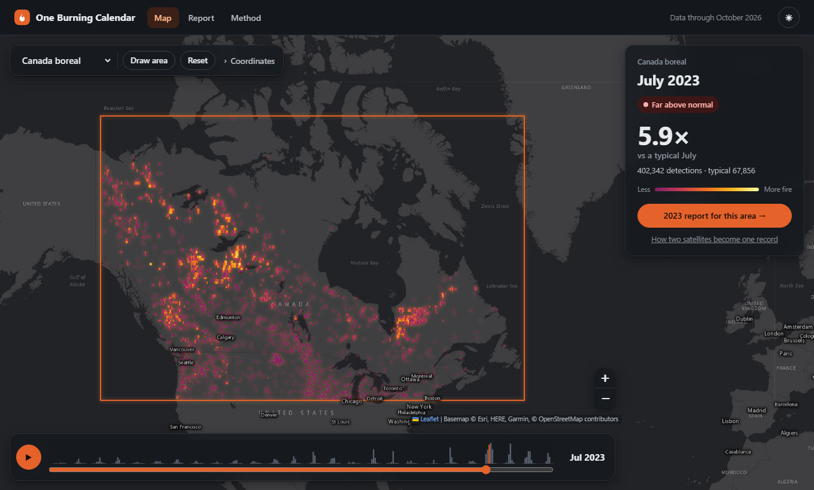
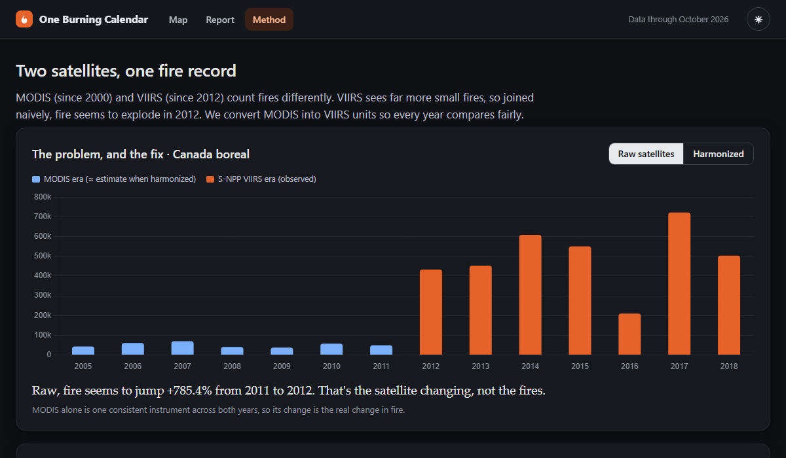
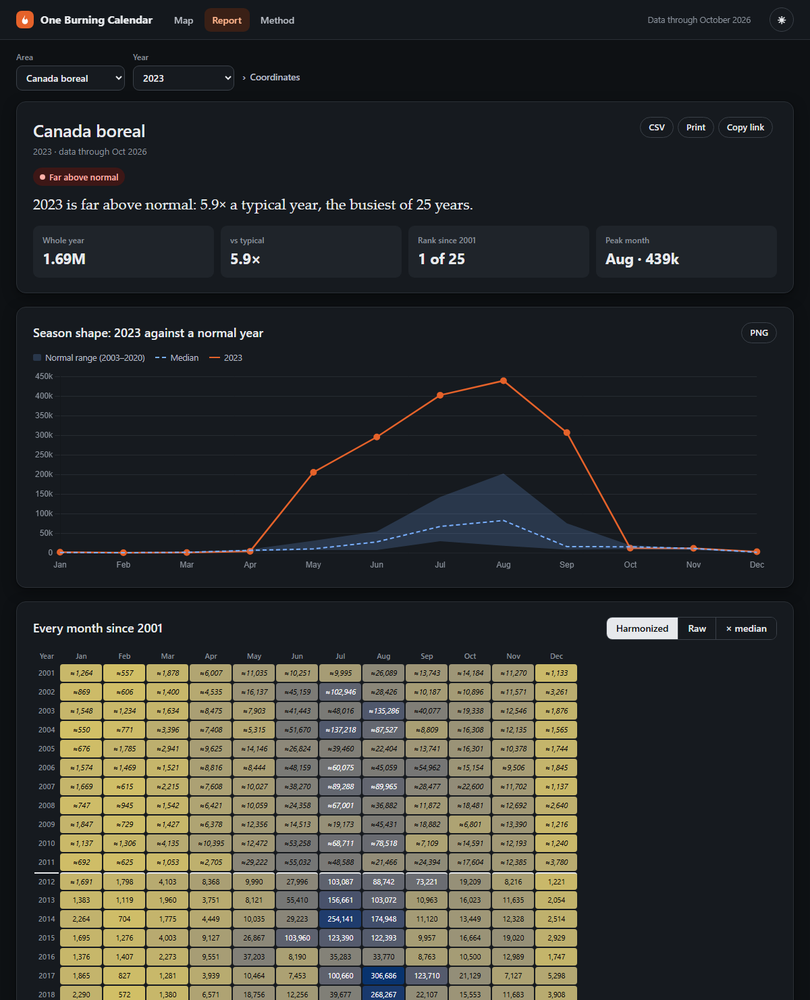

# One Burning Calendar: Harmonization of MODIS and VIIRS Hot Spots

NASA Space Apps Challenge 2026, challenge "Harmonization of MODIS and VIIRS Hot Spots".
Team Murphy: Om, Ishan, Sparsh, Pratham.

**Live app:** https://om200401.github.io/SpaceApps-2026-Harmonization-MODIS-VIIRS/app/
(GitHub Pages, published from the root of `main` and rebuilt on every merge. No login needed.)

One Burning Calendar joins NASA's two satellite fire records into a single monthly
record from 2001 to today, for any area on Earth. A fire manager can ask "is this month
unusual for my area?" and get an answer that doesn't depend on which satellite was flying.



## Results at a glance

These numbers come from running this repo's scripts on NASA FIRMS data. The jump and May 2023 rows are
what the live app shows. The error rows are from [experiments/v2/README.md](experiments/v2/README.md),
which has all nine regions, the method and the caveats.

| Check | Canada | Whole world |
|---|---:|---:|
| Change in yearly detections from 2011 to 2012, raw MODIS + VIIRS added together (the satellite changing, not the fires) | **+785.4%** | **+407.2%** |
| Same change in the harmonized record | **+59.8%** | **+5.6%** |
| Same change measured by MODIS alone, one consistent sensor | +60.5% | +5.2% |
| Monthly error on a hidden year: hide one year of 2012–2021 at a time and predict VIIRS from MODIS alone | **6.5%** | **1.5%** |
| The same test with the previous method | 11.3% | 2.1% |
| Yearly error on a hidden year | 4.3% | 0.7% |
| May 2023, the start of Canada's record season | **19.1×** the 2003–2020 May median | |

Monthly error is the total absolute error over all months divided by the total fire.
Harmonized counts are in S-NPP VIIRS units. Before February 2012 they are estimates
converted from MODIS, and the app marks them with ≈.

The problem, as the app's Method page shows it. Raw counts jump in 2012, when VIIRS starts:



The area report for Canada in 2023, built on the harmonized record:



## How it fits together

```
NASA FIRMS detections (MODIS C6.1 + VIIRS 375 m, 660M rows, mirrored on Hugging Face)
   │  summarise/build_monthly_grid.py
   ▼
Monthly grid: counts per 0.25° cell, month, satellite, day/night    (GitHub Release data-v2)
   │  pipeline/build_global.py      raw counts and the previous conversion rule, whole world
   │  experiments/v2/               v2 rule: one worldwide model, fitted on the raw detections
   │  pipeline/build_global_v2.py   v2 estimates before Feb 2012; observed S-NPP minus gas flares after
   ▼
data/monthly_harmonized_global_v2.parquet                           (local, not in Git)
   │  pipeline/export_tiles.py
   ▼
Tiles: app/data/index.json, d/, c/                                  (GitHub Release tiles-v2)
   │  pipeline/fetch_tiles.py       run locally, and by the Pages workflow before each deploy
   ▼
app/  (static HTML/JS: map, area report, method page)
```

The app covers the **whole world**. It has ten preset areas, among them Canada, the Amazon, the
Mediterranean, US West, Siberia, southern Africa, SE Asia, northern Australia and the whole world,
and you can draw or type any other box.

Two generations of the method are in this repo:

- **v2, what the app shows.** One worldwide gradient-boosted model, documented in
  [experiments/v2/README.md](experiments/v2/README.md).
- **The previous rule** (per-area ratios plus a monthly power law), documented in
  [docs/VALIDATION.md](docs/VALIDATION.md). The Canada-only `app/data/monthly.json` and the
  independent audit below still use it.

## The challenge

Satellites have recorded active fire hotspots for more than 20 years, but the
record is split between two sensor families that can't be compared directly:

- **MODIS** (Terra and Aqua): the long historical record from 2000, now near the end of its life.
- **VIIRS** (S-NPP, NOAA-20, NOAA-21): from 2012 on, with finer 375 m pixels and higher sensitivity, so it detects many more hotspots.

The two differ in spatial resolution, sensitivity and overpass times. Putting
their counts side by side therefore gives a misleading picture of when and where burning happened.

Our task is to build a **web application with a harmonized burning-activity
calendar** for any area a user selects. The challenge comes in two parts:

1. **Harmonization.** Combine NASA FIRMS hotspots from MODIS and VIIRS into one
   consistent monthly series from the early 2000s to today, so the sensor of
   origin no longer matters.
2. **Web application.** The user picks an area (draws it on a map or enters
   lat/lon) and a date range. The app then shows:
   - a year × month calendar of hotspot counts, using an accessible colour ramp
   - the busiest months and years
   - how the current month compares with the historical median (anomalies)
   - a CSV download of the hotspots found

The intended users are emergency responders, fire managers, land managers and scientists.

## Repository layout

```
index.html              redirects the Pages root URL to app/
app/                    the web app (static HTML/JS, no build step)
  index.html            homepage: map, month scrubber, "how unusual is this month?" status
  report.html           area report: verdict, season vs normal range, calendar, downloads
  how-it-works.html     raw vs harmonized, method, accuracy and caveats
  shared.js, shared.css data loading, display rules and page chrome used by all three pages
  data/index.json       tile list the app reads first (made by pipeline/export_tiles.py)
  data/d/, data/c/      worldwide harmonized tiles: 0.25° cells per 10° tile, 1° cells per 30° tile.
                        Not in git: they come from a release (pipeline/fetch_tiles.py)
  data/monthly.json     older Canada-only export, kept for the check scripts
pipeline/               harmonization: summary table -> calibrated monthly data -> app JSON
  build_global.py         production path: harmonizes the whole world (validated regions + 30° boxes), prints holdout per box
  build_global_v2.py      v2 rule: swaps in experiments/v2 estimates before Feb 2012, removes gas flares after
  export_tiles.py         writes the app's tiles and index.json
  fetch_tiles.py          downloads the tiles from their release into app/data/
  build_regions.py        harmonizes the validated regions only (used by build_global.py), prints holdout scores
  build_monthly_from_grid.py, grid_calibrate.py, grid_validate.py
                          slicing, ratio and holdout code that build_regions.py uses
  export_json.py          writes app/data/monthly.json
  verify_all.py           checks the harmonized data and the app JSON agree
  check_outputs.py        stage-by-stage output checks
  audit_engine.py         independent audit: recomputes every shipped number from the raw grid
  audit_claims.json       the audit's claims registry (expected values and tolerances)
  clean_firms.py, calibrate.py, validate_holdout.py
                          earlier path that works from raw FIRMS detections
  make_synthetic.py       synthetic test data (pipeline tests only, never results)
  validate_nbac.py        optional check against Canada's NBAC burned area
summarise/              builds the monthly grid summary table from raw FIRMS data
  build_monthly_grid.py
  README.md             full column reference and caveats
experiments/            scripts that compared conversion rules and chose the ones that shipped
  README.md             the previous rule: about 90 variants, run order, how scoring works
  v2/                   the v2 rule the app shows: one worldwide model, with its own README and results
docs/
  VALIDATION.md         the previous rule: method, holdout results and caveats
  AUDIT_REPORT.md       output of the independent audit (pipeline/audit_engine.py)
  UI_DATA_CONTRACT.md   the shape of the tiles and index.json the app reads
  PROJECT_PAGE.md, DEMO_SCRIPT.md   drafts of the Space Apps project page and the 30-second demo
  OM_TABLE_VERDICT.md   early decision note on using the monthly grid
  img/                  screenshots of the app used in this README
SPEC.md                 the original product spec and decisions log (written before the build)
requirements.txt        Python packages for pipeline/ and summarise/
LICENSE                 MIT
```

To run the app locally, first download the map tiles (`python pipeline/fetch_tiles.py`, 44 MB), then serve the
repo root with any static server (for example `python -m http.server`) and open `/app/`. Opening the HTML
files straight from disk does not work, because the pages fetch their data.
The site is deployed by `.github/workflows/pages.yml`, which fetches the same tiles before publishing.

## Running the pipeline

This rebuilds the app's data from the published summary table. For the worldwide tiles the app reads,
run `python pipeline/build_global.py` then `python pipeline/export_tiles.py` (about 15 minutes; for the v2
rule see `experiments/v2/README.md`). To publish new tiles, zip `index.json`, `c/` and `d/` from `app/data/`,
upload the zip to a new release and set `TILES_TAG` in `pipeline/fetch_tiles.py`;
the steps below rebuild the original region-only outputs.
Run every command from the repo root.

**1. Install the dependencies**

```bash
pip install -r requirements.txt
```

**2. Download the summary table** into `data/derived/`

```bash
gh release download data-v2 --repo OM200401/SpaceApps-2026-Harmonization-MODIS-VIIRS --dir data/derived
```

**3. Calibrate and harmonize each preset region**

```bash
python pipeline/build_regions.py
```

This writes `data/regions/`, `data/monthly_harmonized.parquet` (Canada, the app's region),
`data/monthly_harmonized_all.parquet` (all regions) and `data/calibration_regions.json`.
It also prints each region's ratios and holdout scores. They should match `docs/VALIDATION.md`.

**4. Export the app data**

```bash
python pipeline/export_json.py --monthly data/monthly_harmonized.parquet
```

**5. Check the result**

```bash
python pipeline/verify_all.py
```

It should print `PASS`. If you rebuilt from `data-v2` without changing any code,
`git status` should also show `app/data/monthly.json` unchanged.

**Optional: rerun the Canada holdout on its own**

```bash
python pipeline/grid_validate.py --staging data/regions/canada_staging.parquet
```

## Independent audit

Do not take our word for any number in this project. The audit engine recomputes all of them from the raw data, with completely separate code, and shows its work.

**Scope.** The audit covers the Canada record in `app/data/monthly.json`, which was built with the previous rule (`docs/VALIDATION.md`). The worldwide v2 tiles the app now reads are checked separately, by the hidden-year tests in `experiments/v2/README.md`.

```bash
python pipeline/audit_engine.py --selftest
```

The production pipeline is pandas. The audit rebuilds the data from the 55M-row grid in SQL (DuckDB), refits the harmonization rule from the project's calibration rules (`docs/VALIDATION.md` and the production calibration code), and compares everything against expected values that were written down in advance (`pipeline/audit_claims.json`). The full report is `docs/AUDIT_REPORT.md`.

On that Canada record, it verifies:

- 308,806 cell-months rebuilt from the grid, zero differences
- May 2023 = 208,476, and the 2011 to 2012 jump: +785.4% raw, +60.8% harmonized
- every cell's harmonized value, refit independently, largest difference 0.005, which is the file's own rounding
- the holdout: fit 2012 to 2020, predict 2021 to 2023, MAPE 13.6%
- itself: it corrupts copies of the data 8 ways (quiet drift, swapped values, planted stale numbers) and must catch all 8. It does.

One limit, stated plainly: the audit certifies the Canada record under the previous rule, not the v2 tiles, and in that record the Terra-only months before July 2002 have no holdout coverage, here or anywhere in the project.

## Data

| Dataset | What it is | Size | Where |
|---|---|---|---|
| Raw FIRMS hotspots | All 660M detections, every sensor, Nov 2000 to Nov 2026, Parquet | ~10 GB | Hugging Face: [`undeadphoenix/firms-fire-data`](https://huggingface.co/datasets/undeadphoenix/firms-fire-data) |
| **Monthly grid summary** | Hotspot counts per 0.25° cell per month | 208 MB | GitHub Release: [`data-v2`](https://github.com/OM200401/SpaceApps-2026-Harmonization-MODIS-VIIRS/releases/tag/data-v2) |

**Use the monthly grid summary for almost everything:** the calendar,
harmonization, anomalies and charts. Only the CSV export of individual
hotspots needs the raw data.

### Accessing the summary table

**1. Install the dependencies (once)**

```bash
python -m venv .venv
.venv\Scripts\activate          # Windows  (macOS/Linux: source .venv/bin/activate)
pip install -r requirements.txt
```

**2a. Query it straight from the URL (no download)**

DuckDB reads only the parts of the file it needs, so this takes about a second:

```python
import duckdb

GRID = "https://github.com/OM200401/SpaceApps-2026-Harmonization-MODIS-VIIRS/releases/download/data-v2/monthly_grid_025.parquet"

duckdb.sql(f"""
    SELECT year, month, sum(hotspots) AS hotspots
    FROM '{GRID}'
    WHERE is_vegetation
      AND confidence IN ('n', 'h')
      AND satellite = 'SNPP'
      AND cell_lat BETWEEN 29.5 AND 32.25      -- example: Punjab, India
      AND cell_lon BETWEEN 73.75 AND 76.75
    GROUP BY ALL ORDER BY ALL
""").df()
```

**2b. Or download it once and work locally**

```bash
gh release download data-v2 --repo OM200401/SpaceApps-2026-Harmonization-MODIS-VIIRS --dir data/derived
```

Without the GitHub CLI, download `monthly_grid_025.parquet` from the
[release page](https://github.com/OM200401/SpaceApps-2026-Harmonization-MODIS-VIIRS/releases/tag/data-v2)
into `data/derived/`. Then query `'data/derived/monthly_grid_025.parquet'` the same way.
pandas works too: `pd.read_parquet(path)`. The file has 55M rows, though, so it's usually faster to filter in DuckDB first.

### Columns at a glance

`cell_lat`, `cell_lon` (south-west corner of the 0.25° cell) · `year` · `month` ·
`sensor` · `satellite` (`Terra`, `Aqua`, `SNPP`, `N20`, `N21`) · `daynight` ·
`confidence` (`l`/`n`/`h`) · `is_vegetation` · `hotspots` · `frp_sum`

The full definitions, and how MODIS confidence and the vegetation flag were derived, are in [summarise/README.md](summarise/README.md).

### Before you analyse: three traps

- **MODIS is Terra-only before mid-2002.** Aqua joined in 2002, so the early years look low for that reason alone.
- **VIIRS gained satellites:** NOAA-20 from 2018 and NOAA-21 from 2023. Summing all of them creates a fake upward trend, so pick one satellite (`SNPP` covers 2012 to today).
- **November 2026 is a partial month.** Compare it with the same days in earlier years.

### Rebuilding the summary

You only need this if the grid size or cleaning logic changes. It needs ~10 GB of disk and about 4 minutes:

```bash
python -c "from huggingface_hub import snapshot_download; snapshot_download('undeadphoenix/firms-fire-data', repo_type='dataset', local_dir='data/firms', allow_patterns=['*.parquet'])"
python summarise/build_monthly_grid.py --cell 0.25
```

Publish a new version as a new release (`data-v3`, ...) so nobody's code breaks underneath them.

## Ground rules

- **Never commit data.** `.gitignore` blocks Parquet, CSV, ZIP and `data/`. Large files go to Hugging Face or a GitHub Release.
- **Never commit secrets.** FIRMS MAP_KEY and Hugging Face tokens go in `.env`, which is ignored.
- **Commit messages are one short line.**

## Use of AI

We used AI assistants to speed up building this project. The team directed and reviewed all of it.

| Tool | Used for |
|---|---|
| Claude (Anthropic) | Code (`summarise/build_monthly_grid.py`, parts of `pipeline/` and `app/`), data checks on the FIRMS tables, and documentation (READMEs, `docs/`) |
| Codex (OpenAI) | Code in `pipeline/` |
| Muse Code | Documentation |
| GitHub Copilot Autofix | One fix in `app/index.html` (median calculation) |

- **Ideas and method:** choosing the challenge, the product idea, and the harmonization method choices are the team's own. They include S-NPP as the reference sensor, season × day/night ratios, and the 2012–2020 calibration with 2021–2023 holdout.
- **Data:** every result comes from NASA FIRMS data run through this repo's scripts. `pipeline/make_synthetic.py` generates AI-assisted **synthetic** test data, used only to check that the pipeline recovers a planted ratio. It is labelled as synthetic everywhere it appears (`data/synthetic/`, the "Pipeline test" section of `docs/VALIDATION.md`) and is never shown as a result.
- **Machine learning in the method:** the Space Apps rules count machine learning as AI, so we state it here. The estimates before February 2012 come from a gradient-boosted model (LightGBM) that we trained only on NASA FIRMS data (`experiments/v2/`). The app marks every one of those values with ≈, and values from February 2012 on are observed counts, not model output.
- **Images and video:** none in the app or demo are AI-generated. The screenshots in `docs/img/` are captures of the running app. If any are added, they will carry a visible watermark, as the Space Apps rules require.

## Data sources and references

**NASA data**

- NASA FIRMS (Fire Information for Resource Management System), LANCE / EOSDIS:
  <https://firms.modaps.eosdis.nasa.gov/>. Active fire detections from the MODIS Collection 6.1
  product (Terra and Aqua) and the VIIRS 375 m Collection 2 products (S-NPP, NOAA-20, NOAA-21).
  The harmonized record uses Terra, Aqua and S-NPP only. NOAA-20 is used for one benchmark
  (how well one VIIRS predicts another, in `experiments/v2/`). NOAA-21 is in the raw mirror and the
  monthly grid but is not used in any result.

**Algorithm papers for those products**

- Giglio, L., Schroeder, W., & Justice, C. O. (2016). The collection 6 MODIS active fire detection
  algorithm and fire products. *Remote Sensing of Environment*, 178, 31–41.
  <https://doi.org/10.1016/j.rse.2016.02.054>
- Schroeder, W., Oliva, P., Giglio, L., & Csiszar, I. A. (2014). The New VIIRS 375 m active fire
  detection data product: Algorithm description and initial assessment. *Remote Sensing of
  Environment*, 143, 85–96. <https://doi.org/10.1016/j.rse.2013.12.008>

**Third-party software and services**

| What | Used for | Licence or terms |
|---|---|---|
| [Leaflet](https://leafletjs.com/) 1.9.4 | Map in the app | BSD 2-Clause |
| [Chart.js](https://www.chartjs.org/) 4.4.1 | Charts in the app | MIT |
| Esri World Light/Dark Gray Base and Reference tiles | Basemap and place names | Esri terms of use; attribution is shown on the map |
| [DuckDB](https://duckdb.org/) | Building and querying the monthly grid | MIT |
| [pandas](https://pandas.pydata.org/), [NumPy](https://numpy.org/) | Pipeline | BSD 3-Clause |
| [Apache Arrow (pyarrow)](https://arrow.apache.org/) | Parquet files | Apache 2.0 |
| [huggingface_hub](https://github.com/huggingface/huggingface_hub) | Downloading the raw data mirror | Apache 2.0 |
| [LightGBM](https://lightgbm.readthedocs.io/) | The v2 conversion model (`experiments/v2/`) | MIT |
| [scikit-learn](https://scikit-learn.org/), [SciPy](https://scipy.org/) | `experiments/` only | BSD 3-Clause |
| Cividis and inferno colour maps | Colour-blind-safe ramps for the calendar and map | Cividis: Nuñez, Anderton & Renslow (2018), <https://doi.org/10.1371/journal.pone.0199239>. Inferno: matplotlib, CC0 |

The raw FIRMS mirror is hosted on [Hugging Face](https://huggingface.co/datasets/undeadphoenix/firms-fire-data)
and the monthly grid and the app's map tiles on GitHub Releases. All are the team's own copies of,
or products made from, NASA FIRMS data.

## Licence

This project's own code and documentation are released under the [MIT License](LICENSE).
